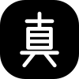

<p align="center">
  
</p>

<h1 align="center">True Design System</h1>

<p align="center"><b>Uma régua para todos os produtos da True Ltda.</b><br/>Monocromático, rápido, no controle de quem usa.</p>

<p align="center">
  
  
  
</p>

---

## Por que existe

O True Download criou uma identidade forte sem documentá-la: o símbolo 真, o preto absoluto, o ouro reservado ao Premium e uma curva de movimento única. Este documento extrai essas decisões do brand kit do True Download e da estética do perfil do Yang, corrige o que a auditoria reprovou e transforma tudo em regras que qualquer produto novo (True Optimizer e os próximos) segue desde o primeiro dia.

**Arquivos**

| Arquivo | Para quê |
|---|---|
| [`tokens.css`](tokens.css) | Todas as variáveis (cor, tipo, espaço, raio, movimento) e componentes base `tds-*` |
| [`../brand/shin.svg`](../brand/shin.svg) | Símbolo oficial 真 |
| Este arquivo | Regras e motivos |

---

## 1. Princípios

1. **Verdadeiro (真).** A interface mostra o estado real: velocidade, espaço, erro. Nada de números enfeitados ou falsas urgências.
2. **Preto e branco primeiro.** A cor é exceção e carrega significado. Se tirar toda a cor, a tela ainda funciona.
3. **Ouro é pagamento.** O ouro aparece só no que é pago. Sem exceção, em nenhum produto.
4. **Um gesto grande por tela.** Um número ou título domina; o resto recua em cinzas.
5. **Rápido no início, macio no fim.** Uma curva só para tudo que se move.
6. **O usuário manda.** Ações destrutivas têm confirmação ou "Desfazer"; foco de teclado sempre visível; movimento reduzido respeitado.

---

## 2. Marca

### Símbolo

O kanji **真** (*shin*, "verdadeiro, genuíno"), em traço único de espessura 6, pontas e junções arredondadas, dentro de um quadrado com raio de **32% do lado**.

| Regra | Valor |
|---|---|
| Área de respiro | 1/4 do lado do símbolo, em todos os lados |
| Tamanho mínimo | 16 px (bandeja do Windows). Abaixo de 20 px, traço 8 |
| Tamanho de barra de título | 22 px (raio 7 px) |
| Cores | Branco sobre preto, ou preto sobre branco. Só isso |

**Não:** dourar o símbolo, girar, afinar o traço, colorir com outra cor, aplicar sombra ou contorno.

### Assinaturas

```
真  True                 ← marca-mãe, peso 600
真  True Download        ← "True" 600 + produto 400 em --fg-2
真  True Optimizer
真  True <Produto>       ← todo produto novo segue este molde
```

O nome do produto nunca ganha logo próprio. O que diferencia os produtos é o nome, não o símbolo.

---

## 3. Cor

Todas as cores vivem em [`tokens.css`](tokens.css). Produto novo **não cria hex** fora dele.

### Núcleo escuro (padrão)

| Token | Hex | Uso | Contraste sobre `--bg` |
|---|---|---|---|
| `--bg` | `#000000` | Fundo | |
| `--bg-1` | `#0a0a0a` | Superfície, cards | |
| `--bg-2` | `#141414` | Hover, campos | |
| `--line` | `#1f1f1f` | Borda sutil | |
| `--line-2` | `#323232` | Borda de controle | |
| `--fg` | `#ffffff` | Títulos, texto principal | 21:1 |
| `--fg-1` | `#c4c4c4` | Corpo | 12,0:1 |
| `--fg-2` | `#808080` | Metadados | 5,3:1 |
| `--fg-3` | `#4d4d4d` | **Só decorativo**, nunca texto | 2,5:1 |

### Núcleo claro (`data-theme="light"`)

| Token | Hex | Contraste |
|---|---|---|
| `--bg` / `--bg-1` / `--bg-2` | `#ffffff` / `#f7f7f7` / `#ededed` | |
| `--fg` | `#000000` | 21:1 |
| `--fg-1` | `#3b3b3b` | 11,2:1 |
| `--fg-2` | `#6b6b6b` | 5,3:1 (corrige o `#777` do app, que dava 4,48:1) |

### Destaque

`--accent` segue o texto: branco no escuro, preto no claro. Botão primário é sempre "o oposto do fundo". Um produto **pode** trocar `--accent` só em tema Premium (ex.: Dark Glass usa `#9ab8ff`), nunca no tema padrão.

### Ouro Premium

| Token | Hex | Uso |
|---|---|---|
| `--gold-hi` → `--gold` → `--gold-2` → `--gold-deep` | `#fff1b8` `#f5c542` `#d49b12` `#a86f00` | Gradiente do selo e do botão Premium |
| `--on-gold` | `#1a1203` | Texto sobre ouro (11,4:1) |
| `--gold-ink` | `#f5c542` escuro / `#9a6a00` claro | Ouro como texto (4,7:1 no claro) |

Onde o ouro aparece: selo verificado, pílula do plano, etiqueta PRO, botão "Seja Premium", recursos travados. Em nenhum outro lugar.

### Semânticas

| Token | Escuro | Claro | Uso |
|---|---|---|---|
| `--ok` | `#4ade80` | `#15803d` | Confirmação, "sem ameaças" |
| `--warn` | `#f59e0b` | `#b45309` | Atenção (disco quase cheio) |
| `--bad` | `#ef4444` | `#c62828` | Erro crítico |
| `--bad-solid` | `#d33b3b` | `#d33b3b` | Fundo do botão destrutivo |

Cor nunca é o único sinal. Erro também usa forma (borda tracejada) e texto.

### Temas Premium

Graphite, Midnight, Sand, Gold e Dark Glass usam **as mesmas chaves** com outros valores (ver `tokens.css`). Todo produto novo herda os 7 temas de graça: basta trocar `data-theme` no `<html>`. No Sand, `--fg-2` passou de `#85775e` para `#6b5d44` para passar em contraste AA.

---

## 4. Tipografia

Fonte do sistema, para parecer parte do Windows 11.

| Papel | Família |
|---|---|
| Texto | `Segoe UI Variable Text` → Segoe UI → Inter → system-ui |
| Display | `Segoe UI Variable Display` → Segoe UI → Inter |
| Mono | `Cascadia Mono` → JetBrains Mono → Consolas |

### Escala (7 tamanhos de app + 2 de site)

| Token | Tamanho / peso | Uso |
|---|---|---|
| `--fs-display` | 64 / 300, `-.04em`, números tabulares | O gesto grande (velocidade, score) |
| `--fs-title` | 28 / 600, `-.02em` | Ofertas, títulos de tela |
| `--fs-section` | 17 / 600 | Modais, estados vazios |
| `--fs-body` | 14 / 500 | Nomes, itens de lista |
| `--fs-meta` | 12,5 / 400, `--fg-2` | Metadados |
| `--fs-label` | 11 / 500, caixa-alta, `+.18em` | Eyebrows, rótulos |
| mono | 10–11 / 600, `+.06em` | Tipo de arquivo (ISO, ZIP) |
| `--fs-body-lg` | 15 / 400 | Corpo de site e documentação |
| `--fs-quote` | 40 / 600, `-.03em` | Frase de marca em site |

Nada abaixo de 11 px. O app do True Download tinha 23 tamanhos; produtos novos usam só esta escala.

---

## 5. Espaço, forma e camadas

- **Espaço:** base 4 (`--s-1` 4 px … `--s-20` 80 px). Gap de grade 12, padding de card 20, entre seções 64.
- **Grupos:** separar grupos de controles com 16 px; dentro do grupo, 6–8 px.
- **Raios:** 6 (código, chip) · 14 (card) · 18 (container) · 999 (botão, pílula, switch).
- **Camadas:** modal desfoca o fundo (`--blur` 14 px) e escurece com `--scrim`. Navegação fixa usa `color-mix(--bg 86%)` com blur.

---

## 6. Movimento

```css
--ease: cubic-bezier(.2, .8, .2, 1);  /* sai depressa, assenta devagar */
--d-fast: .2s;   /* hover, toque */
--d-base: .35s;  /* estado, troca de tema */
--d-slow: .55s;  /* entrada de item */
```

- **Pressionar:** botões vão a `scale(.97)` no clique.
- **Cascata:** ao abrir, blocos sobem `--rise` (14 px) com `--stagger` (80 ms) entre si.
- **Loops infinitos:** só em algo que está acontecendo de verdade (barra de download ativa). O app atual tinha 29; meta é no máximo 1 visível por vez.
- **Movimento reduzido:** `prefers-reduced-motion` e a opção do próprio app desligam tudo (já incluso em `tokens.css`).

---

## 7. Componentes

Classes base em `tokens.css`. Cada produto pode reescrever o HTML, mas mantém aparência e comportamento.

| Componente | Classe | Regras |
|---|---|---|
| Botão | `tds-btn` + `--primary` `--ghost` `--premium` `--danger` | Pílula, 38 px de altura. Um só primário por área |
| Card | `tds-card` | Borda `--line`, fundo `--bg-1`; hover clareia o card inteiro |
| Eyebrow | `tds-eyebrow` | Rótulo acima de título ou número |
| Pílula Premium | `tds-pill-premium` | Só para plano pago |
| Progresso | `tds-progress` com `<i style="--p:62%">` | 3 px, cor `--accent` |
| Toast | `tds-toast` | Invertido (fundo `--fg`); toda ação destrutiva oferece "Desfazer" |
| Filtro segmentado | `.seg` (ver brand kit) | Indicador desliza com `--d-base` |
| Switch | `role="switch"` + `aria-checked` | 38×22, bolinha anda 16 px |

**Ícones:** um ícone = uma consequência. O X só "tira da lista". Cancelar usa quadrado (parar), desagendar usa relógio riscado.

**Estado por forma:** cheio = concluído, tracejado = erro, relógio = agendado.

---

## 8. Voz

**Curta, calma, no controle de quem usa.** Frase de marca: *"Rápido, bonito e no seu controle."*

| Assim | Não assim |
|---|---|
| Baixe qualquer arquivo no navegador e ele aparece aqui. | Configure a integração da extensão para capturar requisições HTTP! |
| Extensão não detectada. Instalar extensão | Bridge offline (ERR_CONN) |
| Download cancelado. Desfazer | Operação abortada com sucesso!!! |

- Uma linha por mensagem, sem exclamação, sem jargão técnico.
- Português (pt-BR) como idioma-base; produtos saem com os 8 idiomas do True Download quando possível.
- Botões em verbo no infinitivo: "Adicionar", "Instalar", "Seja Premium".
- Em materiais de marca (README, banners), títulos de seção em **CAIXA-ALTA** espaçada, como no perfil do Yang.

---

## 9. Acessibilidade (requisito, não opção)

- [ ] `:focus-visible` com contorno de 2 px em todo elemento interativo (já em `tokens.css`).
- [ ] Texto com contraste mínimo 4,5:1; `--fg-3` nunca em texto.
- [ ] Cor nunca é o único sinal (usar forma, ícone ou texto junto).
- [ ] Ação destrutiva: confirmação em dois cliques **ou** toast com "Desfazer".
- [ ] `prefers-reduced-motion` respeitado.
- [ ] Breakpoints que a janela consegue alcançar (se o mínimo é 900 px, não criar breakpoint de 760 px).
- [ ] Altura mínima testada em 1366×768 com escala de 125%.

---

## 10. Começar um produto novo

1. Copie `tokens.css` para o projeto e importe antes de qualquer CSS.
2. Use `<html data-theme="dark">` como padrão; ofereça `light` grátis e os temas Premium pagos.
3. Assinatura: `真 True <Produto>`. Ícone do app é o símbolo 真, sem variação.
4. Escolha **um** gesto grande para a tela principal (o número que importa).
5. Marque com ouro só o que é pago.
6. Passe a lista de acessibilidade da seção 9 antes de cada release.
7. README de releases segue o molde do [README da True Ltda](../profile/README.md): capa, botão BAIXAR, badges, seções em caixa-alta.

---

<p align="center"><sub>真 · True Ltda · TDS v1.0 · nov 2026</sub></p>
